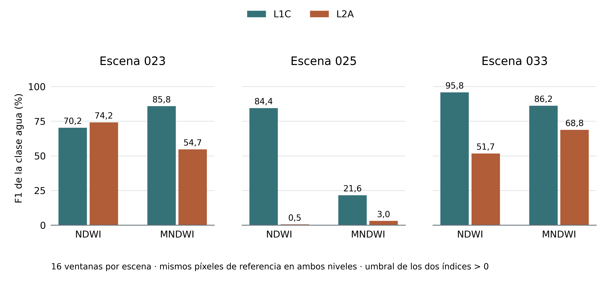

# Segmentación de cuerpos de agua superficiales en Ecuador con Sentinel-2

**Martín Alexander Peña Paladines y Brandon Estefano Castillo Ortega**

¿Cómo cambia la delimitación del agua entre un estuario, un lago andino y un río amazónico? Este trabajo de titulación evalúa una red U-Net con un codificador VGG16 adaptado a cuatro bandas de Sentinel-2. El estudio reúne imágenes de El Oro, el Golfo de Guayaquil, los lagos de Imbabura y el río Napo. La red estima la probabilidad de agua en cada píxel y su delimitación se compara con las máscaras de referencia de cada zona.

[Ruta de reproducción](revision/README.md) · [Métricas por zona](revision/resultados_historicos/historicos_resumen.csv) · [Evaluación externa por escena](revision/analisis_local/escenas_y_pesos.csv)

## Recorrido por las fases

| Fase | Qué se hizo y cómo comprobarlo |
|---|---|
| 1. Recolección en Earth Engine | Se obtuvieron mosaicos Sentinel-2 de 2020–2023 del Golfo, Imbabura y Napo. Se filtraron las nubes y se exigieron al menos tres observaciones claras por píxel. Las imágenes contienen B2 (azul), B3 (verde), B4 (rojo) y B8 (infrarrojo cercano) a 10 m. Se usó también B11 para generar la máscara de agua con MNDWI. [Script ejecutado](metodo_original/gee_v1_ejecutado.js) · [Registro de los mosaicos](revision/decisiones_y_procedencia/procedencia_mosaicos_gee.csv) |
| 2. Recorte, auditoría y partición | Se combinaron 555 pares de El Oro con 305 nuevos en parches de 256 × 256 y se exigió un mínimo de 50 píxeles de agua. De los 860 pares, se excluyeron 174 de El Oro con valores espectrales cero de origen incierto y otros 125 para mantener la separación espacial. Quedaron **460 para entrenamiento, 42 para validación y 59 para prueba**. [Recorte y unificación](metodo_original/fase2_recortar_unificar.py) · [Partición final](manifiestos/particion.csv) · [Trazabilidad de El Oro](revision/decisiones_y_procedencia/trazabilidad_555_el_oro.csv) |
| 3. Entrenamiento de U-Net/VGG16 | El ensayo técnico usó 40 parches y dos épocas. La corrida final completó 50 épocas con entradas normalizadas, giros, reflejos y una pérdida que combinó entropía cruzada binaria con Dice. Se seleccionó el checkpoint por pérdida de validación. [Código](metodo_original/fase3_entrenar_unet.py) · [Cuaderno](metodo_original/fase3_UNet_VGG16_4canales.ipynb) · [Configuración](metodo_original/entrenamiento_original.json) · [Historial](metodo_original/history_final_original.csv) · [Reanudación](metodo_original/reanudar_final_20261005.py) |
| 4. Evaluación y revisión del estudio | Se repitió la inferencia sobre las imágenes históricas originales, se midió la distribución de las cuatro bandas en entrenamiento y se compararon U-Net, NDWI y MNDWI en el conjunto externo S1S2-Water. Un diagnóstico adicional contrastó dos niveles de procesamiento Sentinel-2 en 48 ventanas emparejadas. [Protocolo externo](revision/insumos_externos/protocolo_evaluacion_externa.md) · [Estadísticas de entrada](revision/bandas_train/) · [Lectura del diagnóstico](revision/diagnostico_l1c_l2a_v1/lectura_escenas.md) |

## Resultados en Ecuador

El historial registra cómo evolucionó la pérdida en entrenamiento y validación durante las 50 épocas. [Curvas de entrenamiento y validación](revision/figuras/perdida_entrenamiento_validacion.png)

La intersección sobre la unión (IoU) mide el área de agua que comparten la predicción y la referencia respecto del área que ambas abarcan. F1 combina la proporción de predicciones de agua correctas con la proporción de agua de referencia que se recuperó. Para U-Net se aplicó un umbral de probabilidad de 0,5. Para NDWI se clasificó como agua el valor del índice mayor que cero.

| Cohorte | Píxeles evaluados | IoU U-Net | IoU NDWI | F1 U-Net | F1 NDWI |
|---|---:|---:|---:|---:|---:|
| 59 recortes originales | 3 866 624 | 88,43 % | 80,92 % | 93,86 % | 89,45 % |
| 55 sin exposición previa documentada | 3 604 480 | 87,71 % | 79,58 % | 93,45 % | 88,63 % |

La nueva inferencia reprodujo los conteos de la evaluación original en las cuatro zonas. El F1 de U-Net pasó de **93,86 % al reunir los píxeles a 67,53 % al dar el mismo peso a cada zona**. El Golfo aportó 687 613 de los 908 590 píxeles de agua de referencia. Imbabura aportó un solo recorte, que ya se había examinado en el ensayo técnico y quedó fuera del subconjunto de 55. Las métricas miden concordancia con las etiquetas disponibles. Las etiquetas de los tres mosaicos nuevos proceden de MNDWI y la generación de las de El Oro tiene documentación parcial. [Conteos por recorte](revision/resultados_historicos/historicos_por_recorte.csv) · [Comprobación con la corrida original](revision/resultados_historicos/comparacion_con_original_59.csv) · [Cronología de los cuatro casos](revision/decisiones_y_procedencia/informe_documental.md)

Como complemento a la prueba histórica, se revisaron cinco recortes de validación con sus respectivas máscaras y cinco escenas ecuatorianas de 2025. Para estas últimas se documentan las superficies predichas y el área evaluable. Las columnas de IoU y F1 quedan vacías porque estas escenas carecen de una máscara independiente. [Recortes de validación](revision/casos_ecuador/cinco_recortes_validacion.csv) · [Escenas de 2025](revision/casos_ecuador/escenas_ecuador_2025.csv) · [Identificadores de adquisición](revision/casos_ecuador/procedencia_escenas_2025.json)

## Evaluación externa

Se reservaron 256 ventanas de 16 escenas del conjunto oficial de prueba S1S2-Water. Sus máscaras se iniciaron con NDWI y fueron corregidas por tres expertos. La comparación usó el mismo soporte válido para los tres métodos. Tres ventanas carecían de píxeles evaluables. [Plan de ventanas](revision/insumos_externos/plan_congelado.json) · [Atribución y fuentes](revision/insumos_externos/ATRIBUCION.md)

| Forma de resumir el F1 | U-Net | NDWI | MNDWI |
|---|---:|---:|---:|
| Todos los píxeles válidos | 93,90 % | 95,72 % | 95,66 % |
| Igual peso para cada una de las 16 escenas | 87,06 % | 82,96 % | 81,92 % |

La diferencia de F1 entre U-Net y NDWI cambió de −1,82 a +4,10 puntos porcentuales al pasar del cálculo global al promedio por escena. Los intervalos exploratorios de ambas diferencias incluyeron el cero. [Métricas e intervalos](revision/analisis_local/metricas_globales_y_medias_con_ic.csv) · [Diferencias pareadas](revision/analisis_local/diferencias_pareadas_con_ic.csv)

Las tres escenas de la figura se eligieron para investigar discrepancias ya observadas. Para cada una se mantuvieron las ventanas, las etiquetas y el umbral cero mientras se comparaban la reflectancia en el techo de la atmósfera (L1C) y la reflectancia de superficie (L2A). En S025, el F1 de NDWI pasó de 84,44 % a 0,52 %. En S023 pasó de 70,25 % a 74,17 %. [Conteos y métricas del diagnóstico](revision/diagnostico_l1c_l2a_v1/metricas_indices_por_escena.csv)



La distribución del agua de referencia ayuda a interpretar las diferencias entre escenas. [F1 y cantidad de agua en las 16 escenas externas](revision/figuras/f1_escenas_externas.png) · [Fuentes de las figuras](revision/figuras/ATRIBUCION.md)

## Reproducir las pruebas

Desde la raíz del repositorio, con Python 3.12, estos comandos ejecutan pruebas unitarias y reproducen los intervalos de la evaluación externa a partir de los conteos incluidos.

```sh
python -m pip install -r requirements.txt
python -m unittest test_baseline_ndwi -v
python -m unittest discover -s revision/analisis_local -p "test_*.py" -v
python revision/analisis_local/analizar_escenas.py
```

El último comando crea `revision/estadistica_recalculada/`. Para repetir el cálculo de NDWI sobre Ecuador, se necesitan los 59 pares originales en `Dataset_UNet_Unificado/images/` y `Dataset_UNet_Unificado/masks/`. El programa verifica las huellas SHA-256 y la cuadrícula antes de calcular los conteos.

```sh
python baseline_ndwi.py --splits manifiestos/particion.csv --exposure manifiestos/exposicion.csv --manifest manifiestos/pares_prueba.csv --dataset-root Dataset_UNet_Unificado --out-dir resultados_locales
```

La guía de reproducción contiene los comandos para evaluar el checkpoint, recuperar las ventanas externas y verificar los 315 mapas de probabilidades. La carpeta `resultados/` conserva el primer cálculo de NDWI. La nueva inferencia histórica completa está en `revision/resultados_historicos/`. [Guía detallada](revision/README.md) · [Inventario de probabilidades](revision/inventario_probabilidades.csv)

## Acceso a datos y pesos

Los GeoTIFF de El Oro y el checkpoint de la corrida final están bajo custodia del equipo. La redistribución de los pares de El Oro requiere documentar la autorización del titular. La revisión conservó la trazabilidad de los 555 pares, los filtros históricos de Earth Engine y los conteos por sector. El listado exacto de gránulos que integraron los mosaicos originales sigue sin recuperarse. [Informe de procedencia](revision/decisiones_y_procedencia/informe_documental.md)

S1S2-Water v1.0.1 se distribuye bajo CC BY 4.0. Los productos Sentinel-2 tienen sus propias condiciones de uso. [Datos externos de Wieland y colaboradores](https://zenodo.org/records/11278238) · [Atribuciones y condiciones](revision/insumos_externos/ATRIBUCION.md)
